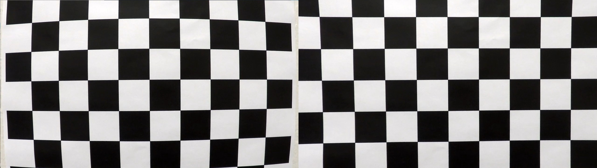
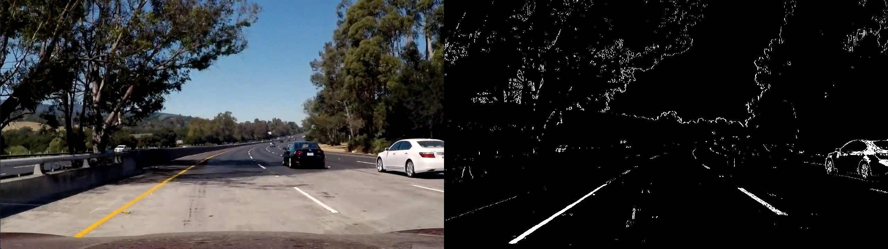
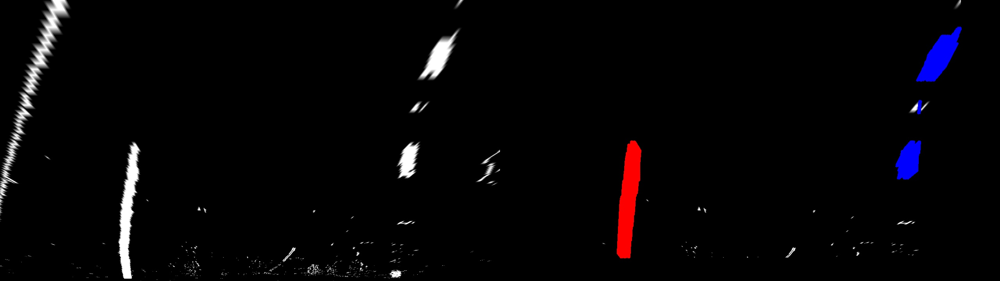
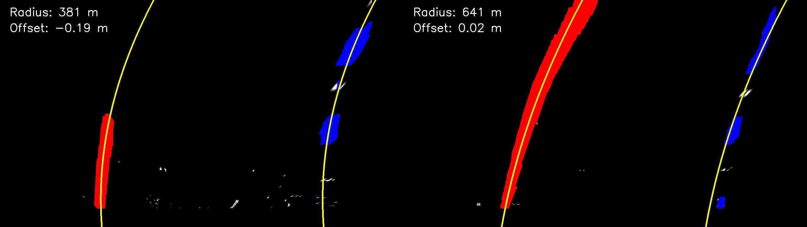
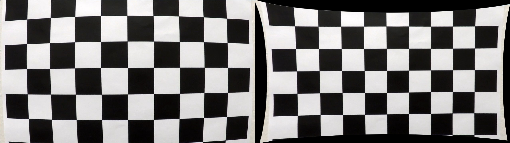
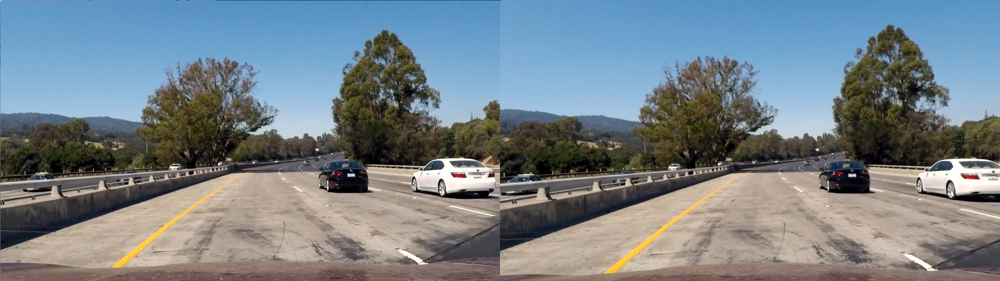
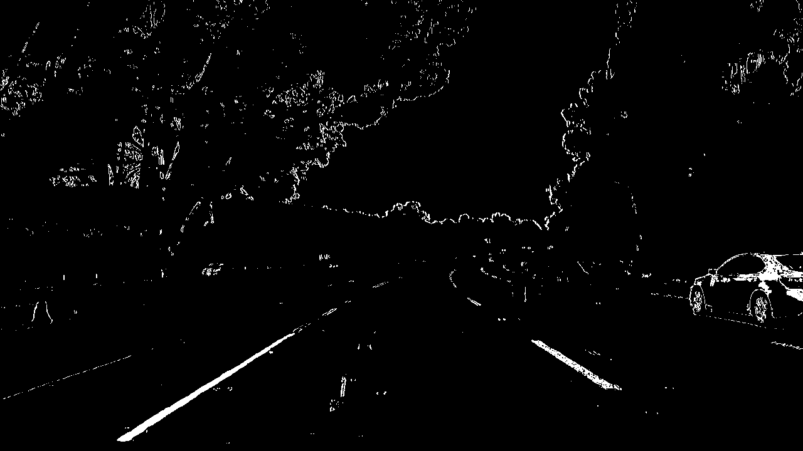
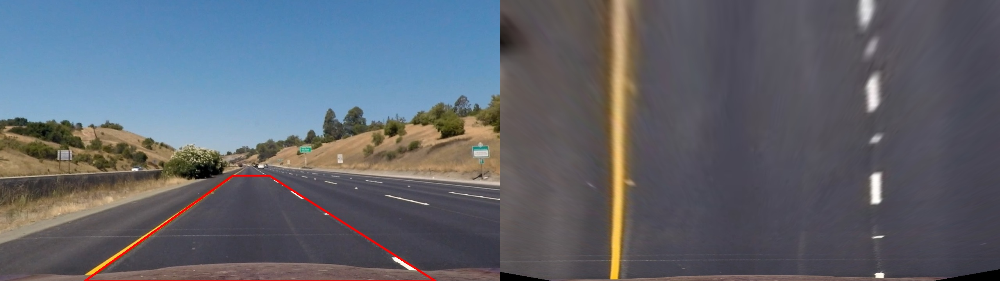

<<<<<<< HEAD
# Lane Finding Project (ADAS)

A lane-finding pipeline for road images, written in Python with OpenCV. Everything lives in one file, `pipeline.py`: each step is its own function and `process()` chains them together. Results are shown with `cv.imshow`, and the images are in `img/`.

What the pipeline does, step by step:

* Compute the camera matrix and distortion coefficients from chessboard photos.
* Undistort the raw road images.
* Build a thresholded binary image from color and gradient information.
* Warp it to a bird's-eye view with a perspective transform.
* Find lane pixels with a Hough transform and fit a polynomial to them.
* Estimate the lane curvature and the vehicle's offset from the lane center.
* Draw the detected lane back onto the original image. *(TODO)*
* Run it on a video. *(TODO)*

## Project structure

```
adas-project/
├── pipeline.py        # the whole pipeline
├── requirements.txt   # opencv-python, numpy
├── img/               # calibration*.jpg (20 chessboards), road test images, calib.npz
├── examples/          # images used in this README
└── README.md
```

## Running it

```bash
pip install -r requirements.txt     # opencv-python, numpy
python pipeline.py                  # every test image in img/
python pipeline.py img/test1.jpg    # a single image
python pipeline.py --recalibrate    # redo img/calib.npz
```

If `img/calib.npz` is missing, the script calibrates the camera on `img/calibration*.jpg` first. For each road image it opens six windows, tiled in a 3x2 grid (original, undistorted with the source trapezoid, binary, bird's-eye view, Hough segments, polynomial fit with radius and offset). Press any key for the next image, ESC to quit. The console prints a small table with radius, offset and lane width. Since it uses `imshow`, it needs a machine with a display. Paths are resolved relative to `pipeline.py`, so it can be started from any folder. Images that are not 1280x720 are resized, because the calibration and the perspective points assume that size.

| Function in `pipeline.py` | Step |
|---|---|
| `calibrate()` | camera calibration (20 chessboard images) |
| `undistort()` | distortion correction |
| `threshold()` | binary image (S channel + Sobel) |
| `warp()` | perspective transform |
| `find_lane_points()` | Hough segments in the bird's-eye view |
| `fit_lanes()` | polynomial fit (shared by both lanes) |
| `measure()` | curvature radius and vehicle offset |
| `process()` | runs all steps on one image |

## Camera Calibration

#### 1. How the camera matrix and distortion coefficients were computed

The code is in `calibrate()` and follows the same flow as `09_01_calibration.py` from the course repo. For each of the 20 chessboard photos in `img/calibration*.jpg`, the corners are found with `cv.findChessboardCorners` and refined with `cv.cornerSubPix`. The matching 3D points are just the grid coordinates of the corners (in chessboard squares, with `z = 0`). Both sets go into `cv.calibrateCamera`, and the result is saved to `img/calib.npz`.

Images 1, 4 and 5 are cropped, so the full 9x6 pattern isn't visible in them. The code tries a few smaller patterns (9x5, 6x5, 7x6) when 9x6 fails, which lets all 20 images be used.

| Quantity | Value |
|---|---|
| RMS error | 0.996 px |
| "Total error" (formula from `09_01`) | 0.124 |
=======
# Lane Finding Project

Koraci projekta:

* Izračunati matricu kamere i koeficijente distorzije iz slika šahovske table.
* Ispraviti distorziju na sirovim slikama.
* Koristiti prelaze boja i gradijente za binarnu sliku.
* Primeniti perspektivnu transformaciju ("bird's-eye view").
* Detektovati piksele trake i fitovati polinom. *(sledeći korak)*
* Odrediti krivinu trake i poziciju vozila u odnosu na centar. *(sledeći korak)*
* Vratiti detektovanu traku na originalnu sliku. *(sledeći korak)*
* Prikazati rezultat sa numeričkim vrednostima. *(sledeći korak)*

## Pokretanje

```bash
pip install -r requirements.txt
python src/calibrate_camera.py   # kalibracija -> output/calibration.npz
python src/pipeline.py           # koraci 1-3 nad test_images/ -> output_images/
```

## Camera Calibration

#### 1. Kako su izračunati matrica kamere i koeficijenti distorzije

Kod je u `src/calibrate_camera.py`. Za svaku od 20 slika šahovske table u `camera_cal/` pozivam `cv.findChessboardCorners` i preciziram uglove sa `cv.cornerSubPix`. Pripremljene su "objektne tačke" `objp`: 3D koordinate uglova table u jedinicama polja, sa `z = 0` (tabla je ravna). Za svaku uspešno pronađenu tablu dodajem `objp` u `objpoints`, a pronađene uglove u `imgpoints`.

Slike 1, 4 i 5 su isečene i na njima ne postoji ceo obrazac 9x6, pa kod redom isprobava rezervne obrasce (9x5, 6x5, 7x6). Tako je iskorišćeno svih 20 slika.

Zatim `cv.calibrateCamera` daje matricu kamere i distorziju. Rezultati se čuvaju u `output/calibration.npz`.

| Stavka | Vrednost |
|---|---|
| RMS greška | 0.996 px |
>>>>>>> 410d79265b3c7984e4962ab54fb5cd76d250327d
| fx, fy | 1161.3, 1158.5 px |
| cx, cy | 666.7, 389.6 px |
| [k1, k2, p1, p2, k3] | -0.258, 0.062, -0.0002, -0.0001, -0.148 |

<<<<<<< HEAD
Original on the left, undistorted on the right:



## Pipeline (single images)

#### 1. Distortion-corrected image

`undistort()` calls `cv.undistort` with the parameters from `calib.npz`. The difference is easiest to see near the image edges and around the car hood (original left, corrected right):


#### 2. Binary image (color + gradient)

`threshold()` combines two masks with a logical OR:

* **S channel of HLS** (170-255) picks up yellow and white lane paint and copes well with changing light.
* **Sobel in x on the L channel** (20-100) picks up near-vertical edges.

Pixels with lightness L < 120 are dropped. Shadows have a high S value, but a lane marking is never dark, so this removes a lot of false positives from tree shadows.



#### 3. Perspective transform

`warp()` is written in the same style as `translate()` and `rotate()` in `00_02_transformations.py`, except it uses `getPerspectiveTransform` and `warpPerspective`. An affine transform can't turn a trapezoid into a rectangle, so it wouldn't work here. The source points were picked by hand on `straight_lines1.jpg`:

| Point | Source | Destination |
|---|---|---|
| top left | (595, 450) | (300, 0) |
| top right | (690, 450) | (980, 0) |
| bottom right | (1115, 720) | (980, 720) |
| bottom left | (216, 720) | (300, 720) |

On the straight-road image both lanes come out parallel and vertical after the warp (red trapezoid on the left, bird's-eye view on the right):


#### 4. Lane pixels (Hough) and polynomial fit

This lives in `find_lane_points()` and `fit_lanes()`.

1. **Hough.** `cv.HoughLinesP` runs on the binary bird's-eye image. First, a few regions are masked out because they only produce false segments: the left 200 px (the jagged road edge), the right 100 px, and the bottom 60 px (noise from the hood).
2. **Filtering.** Segments tilted more than about 35° from vertical are discarded. The rest are assigned to the left or right lane depending on whether their midpoint is left or right of the image center. Each segment is turned into points about 2 px apart, so longer segments count for more.
3. **Removing noise.** For each lane, a small RANSAC (2 random points, 300 tries, fixed seed) finds the straight line with the most points within ±40 px. Anything farther away is treated as noise.
4. **Fitting.** The model is `x = A·y² + B·y + C`, with `y` as the independent variable because the lanes are close to vertical. In the bird's-eye view the lanes are parallel, so both share `A` and `B` and differ only in `C`. The fit uses the points of both lanes at once (`np.linalg.lstsq`), with three rounds of dropping points more than 25 px from the curve.
5. **Sanity check.** A lane is only used if its segments cover at least 5 of 9 horizontal bands of the image. If one lane fails the check, its `C` is derived from the other lane by shifting it one lane width (680 px).

Red segments are the left lane, blue the right lane, and the yellow line is the fitted curve.





Why a shared fit? Fitting each lane on its own gave wildly different radii for the same road (for example 14700 m vs 261 m on one image). Hough segments are short and only cover part of the image height, so a separate quadratic extrapolates badly. Using all points together is much more stable.

#### 5. Curvature and vehicle position

This is `measure()`.

* **Pixels to meters.** `YM_PER_PIX = 30/720` and `XM_PER_PIX = 3.7/680`. These are the usual assumptions (about 30 m of road in view, a 3.7 m lane that is 680 px wide after the warp), not measurements for this camera.
* **Radius.** The curve is refitted in meters and the radius is computed as `R = (1 + (2·A·y + B)²)^1.5 / |2·A|` at the bottom of the image, the point closest to the car. Because both lanes share `A` and `B`, they have the same radius.
* **Position.** The camera is assumed to sit at the center of the car (`x = 640`). The offset is the distance between the image center and the lane center at the bottom of the image. A negative value means the car is left of center.
* **Check.** The printed lane width in pixels should be close to 680.

| Image | Radius [m] | Offset [m] | Lane width [px] | Radius from an earlier sliding-window experiment [m] |
|---|---|---|---|---|
| straight_lines1 | 1879 | 0.11 | 652 | 8015 |
| straight_lines2 | 3310 | 0.05 | 679 | 7647 |
| test1 | 381 | -0.19 | 704 | 425 |
| test2 | 313 | -0.23 | 656 | 373 |
| test3 | 641 | 0.02 | 648 | 476 |
| test4 | 465 | -0.30 | 700 | 752 |
| test5 | 453 | 0.04 | 738 | 464 |
| test6 | 22359 | -0.03 | 660 | 837 |

A few caveats:
* On straight roads the radius is in the kilometers and depends heavily on noise, so treat those numbers as rough.
* The Hough and sliding-window results disagree on some images (`test4`, `test6`), which shows that a single-image curvature estimate can be off by tens of percent. There is no ground truth here to say which one is closer.
* The measured lane width is up to about 8% away from 680 px, so the source/destination points and the 3.7 m assumption are only approximate.

#### 6. Result drawn back onto the road
=======
Primer ispravljene slike (levo original, desno ispravljeno):



## Pipeline (single images)

#### 1. Primer slike sa ispravljenom distorzijom

Funkcija `undistort()` u `src/pipeline.py` učitava `calibration.npz` i poziva `cv.undistort`. Najviše se vidi na ivicama slike i na haubi automobila (levo original, desno ispravljeno):



#### 2. Binarna slika (boja + gradijent)

Funkcija `threshold()` u `src/pipeline.py` kombinuje dva kriterijuma operatorom OR:

* **S kanal HLS prostora** (prag 170-255): hvata žute i bele trake i dosta je otporan na promene osvetljenja.
* **Sobel po x nad L kanalom** (prag 20-100): hvata skoro vertikalne ivice, odnosno linije trake.

Pored toga, maskiram piksele sa svetlinom L < 120, jer senke imaju visok S kanal, a traka ne može biti tamna. Bez ove maske senke drveća daju mnogo lažnih piksela.



#### 3. Perspektivna transformacija

Funkcija `warp()` u `src/pipeline.py` koristi `cv.getPerspectiveTransform` i `cv.warpPerspective`. Izvorne tačke sam odabrao ručno na slici `straight_lines1.jpg`, a odredišne tako da trake postanu vertikalne i paralelne:

| Tačka | Izvor (src) | Odredište (dst) |
|---|---|---|
| gore levo | (595, 450) | (300, 0) |
| gore desno | (690, 450) | (980, 0) |
| dole desno | (1115, 720) | (980, 720) |
| dole levo | (216, 720) | (300, 720) |

Provera: na slici sa pravim putem obe trake posle transformacije postaju paralelne vertikalne linije (crveni trapez levo, ptičija perspektiva desno).



Funkcija `warp()` vraća i inverznu matricu `Minv`, koja će trebati za vraćanje trake na originalnu sliku.

#### 4. Detekcija piksela trake i fit polinoma

TODO

#### 5. Krivina i pozicija vozila

TODO

#### 6. Rezultat ucrtan na put
>>>>>>> 410d79265b3c7984e4962ab54fb5cd76d250327d

TODO

## Pipeline (video)

TODO

## Discussion

TODO
<<<<<<< HEAD

## Tools

Parts of this project (code and README drafting) were developed with the help of an AI assistant. *(Keep or remove this note according to your course's rules.)*
=======
>>>>>>> 410d79265b3c7984e4962ab54fb5cd76d250327d
